## A robot can tick the "I'm not a robot" box

You've clicked that box a thousand times without thinking about it. I never did either, until I realised it doesn't actually check anything. A robot can tick it just as easily as you can.

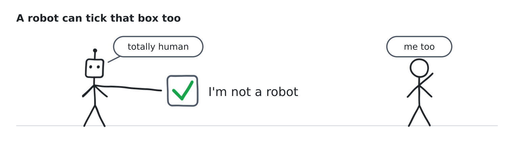

The box was only one small piece of a bigger trick. Websites used a handful of cheap checks like it to keep bots away from ticket queues, sign-up forms and checkout pages, and for a long time that was enough because bots were clumsy.

They aren't clumsy anymore. And a new kind of visitor has turned up: AI assistants that browse, compare prices, fill in forms and buy things on your behalf. Some of them are exactly the customer a shop wants. Some aren't. The old checks can't tell which is which.

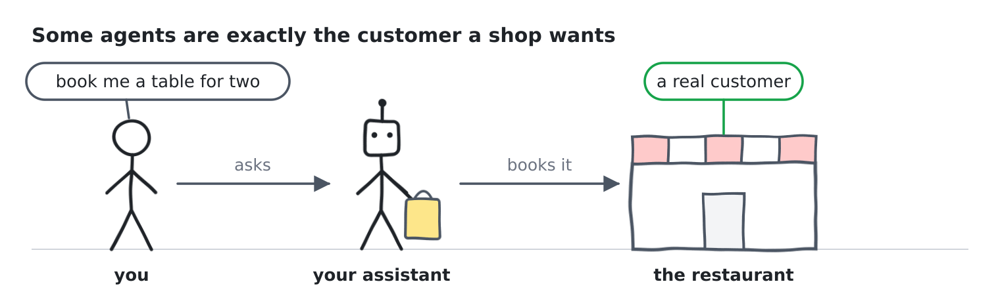

This post is my attempt to explain how we got here, without the jargon.

## How the old bouncers worked

Those "pick all the traffic lights" puzzles were never really about traffic lights. The site was watching how you solved them: where your cursor wandered, how long you hesitated, whether your browser looked like it had been used before. People are messy. Scripts move in dead straight lines.

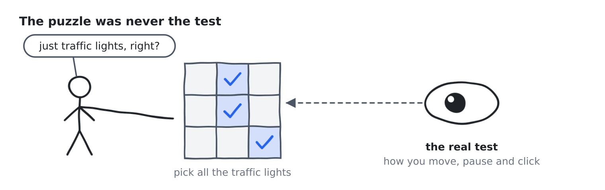

The other trick was just counting. Reload a page ten times in a few seconds and you'd get sent to a "prove you're human" page.

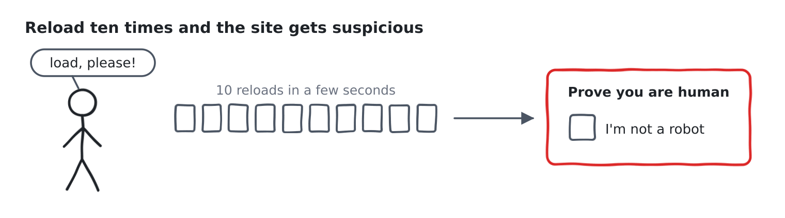

Both tricks bet on the same thing, that a robot behaves like a robot. Too fast, too perfect, too repetitive.

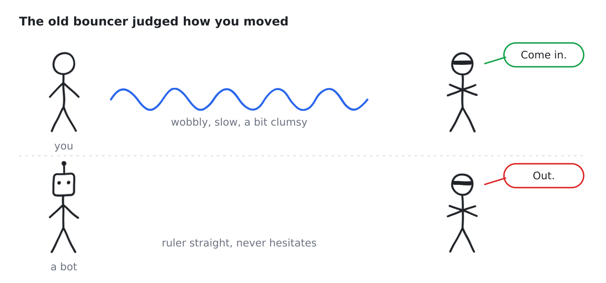

That bet is losing now. A modern agent can read the screen, move a mouse the way a person does and take its time.

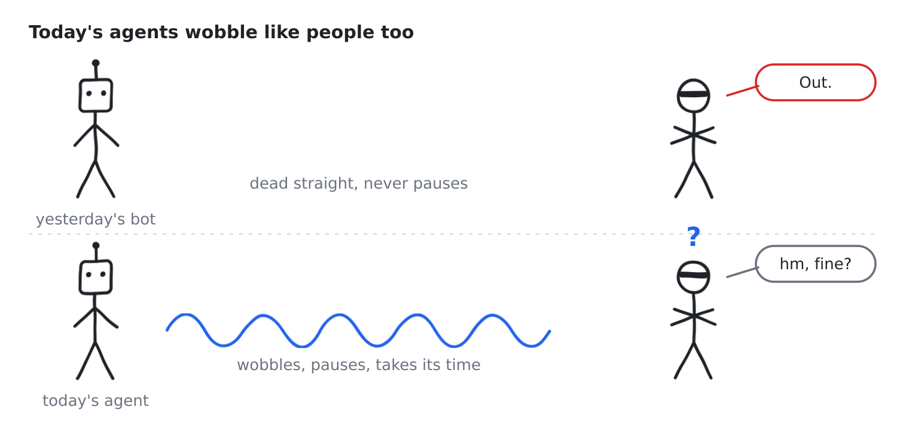

## robots.txt is a sign, not a fence

Every website can put a small text file at a fixed address called `robots.txt`. It works like a sign on the lawn. It tells visitors like search engines and AI crawlers which parts of the site they can walk into and which parts are off limits.

The thing to notice is that it's only a sign. There's no fence and no guard. A polite bot reads it and stays out. A rude one walks straight across the grass.

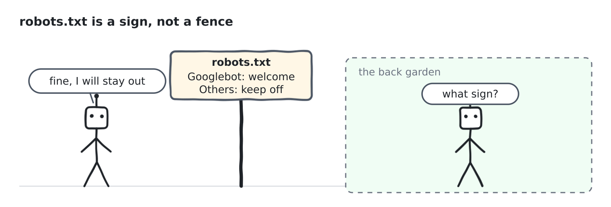

There's also a grey area that keeps getting bigger. A crawler that collects pages to train an AI model is one thing. An assistant that fetches a page because you asked it to is another, and plenty of companies say that second case is just you browsing, so the sign doesn't apply. Most of today's arguments are about exactly that.

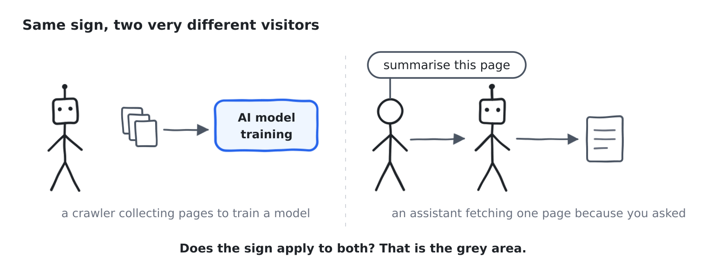

## llms.txt is the welcome mat

If `robots.txt` is about where not to go, `llms.txt` is the opposite: a guide waiting at the door. It's a plain file that was proposed in 2024. It gives an AI a clean map of your site, with the important pages listed and a line on what each one covers.

It doesn't give permission to anyone and it doesn't block anyone. It just makes the site easier for an AI to read, a bit like a menu in a language the traveller actually understands.

So the web ends up with two small files that do two different jobs. One says who is allowed in. The other says where the good stuff is. Neither of them asks the question every site actually cares about, which is who this visitor really is and whether to trust them.

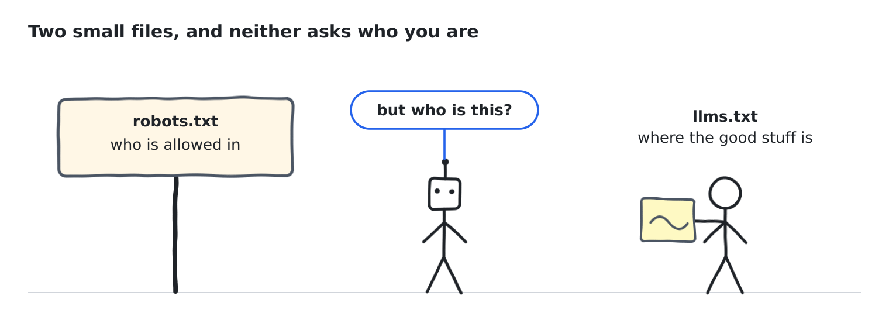

## Robots now use real browsers

The first bots just downloaded the raw text of a page. That's easy to spot, because no real person browses that way.

Modern agents open a real browser instead. It's the same engine that runs on your laptop, only with the window switched off, which is why it's called a headless browser. It loads the page, runs the scripts, keeps cookies and sees the site exactly the way you would.

A tool like Playwright is the remote control for it. A program says click here, type this, wait for the next page, and the browser does it with real clicks and real key presses. It even waits for a button to show up before pressing it, which is more patient than most of us.

To the website that looks a lot like a person. It isn't perfect, but it's close and it's getting closer.

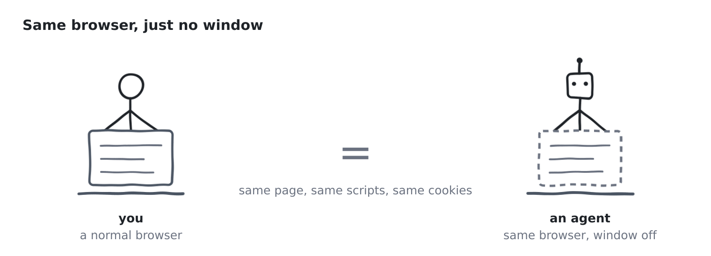

## So what does a website do now?

The cursor test doesn't work any more and neither does the puzzle. Sites now look at smaller things: how the browser describes itself, how its connection looks, whether the address belongs to a house or a data centre, how it behaves over a whole visit. Any of these can be faked, so defenders pile up dozens of them and it never really ends.

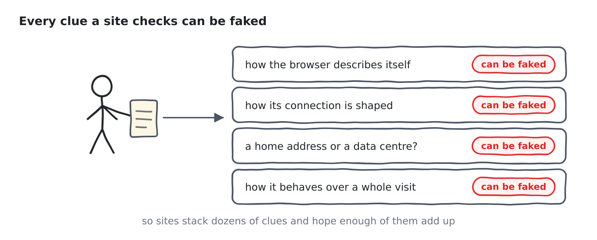

In September Nikita Bier wrote that bot detection and human verification are going to be one of the most urgent things businesses need, because swarms of agents will flood websites and forms, and small companies and government sites will suffer most. Paul Graham replied that this isn't one startup idea but several. Some will filter agents out and some will welcome them in, in an orderly way.

That second part is what stuck with me. Not every agent is bad. If your own assistant books a table or buys a gift, that's a real customer who happens to be software. Block everything that isn't human and you turn away where things are going. Let everything in and you drown.

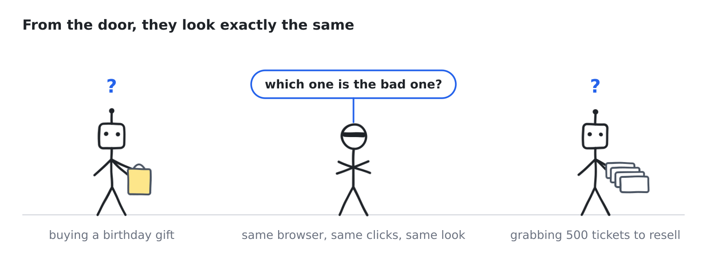

So every website ends up facing the same fork: keep them out, or let them in properly.

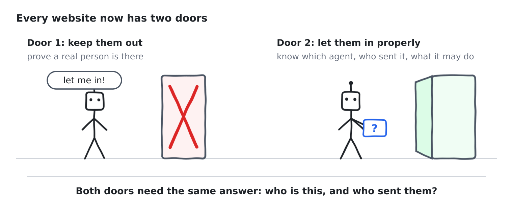

Both roads need the same thing underneath, an answer to who this is and who they are acting for.

## It started with a tweet

My colleague Mohammad spends a lot of time on X. He came across that exchange between Nikita Bier and Paul Graham and spotted something the rest of us had missed: the fork they were describing wasn't coming someday. It was already here, and nobody had built an answer.

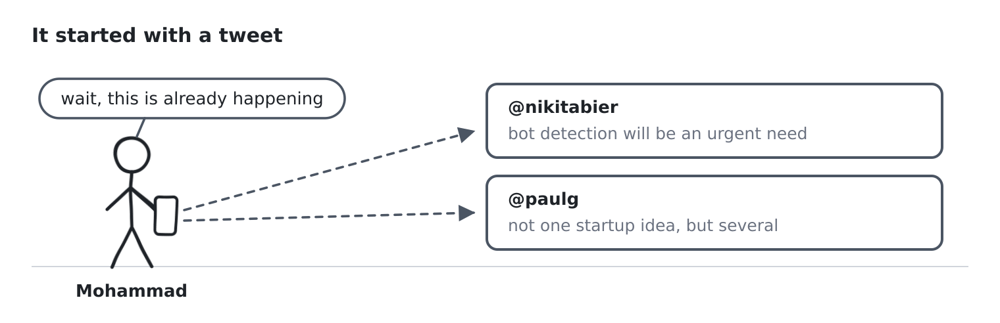

The timing worked out. TrueFoundry was running its *Agents That Act* hackathon around an agent harness, which is a setup where AI agents use real tools to get real work done instead of just chatting. We had OpenAI credits to run the agents, a deadline, and one question we couldn't leave alone.

So we did what you do at a hackathon and stopped talking about it. Within a couple of hours we had a working system and a live demo: agents on both sides of the problem, and scenarios designed to fool us. I won't go into how it works here. What I'll say is that it's the sort of thing teams usually spend weeks planning, and it was running while most of the room was still deciding what to build.

It was Mohammad's idea to start. The rest was a fast, intense build, and when the results came in we had placed third, as second runner-up.

## The question I can't stop thinking about

What should a website do when it can't tell a helpful agent from a harmful one, and a wrong guess costs real money?

I won't give the whole answer here. What I will say is that the old bouncers got one thing wrong. They judged visitors by how they looked. What matters is how they behave and what they can prove.

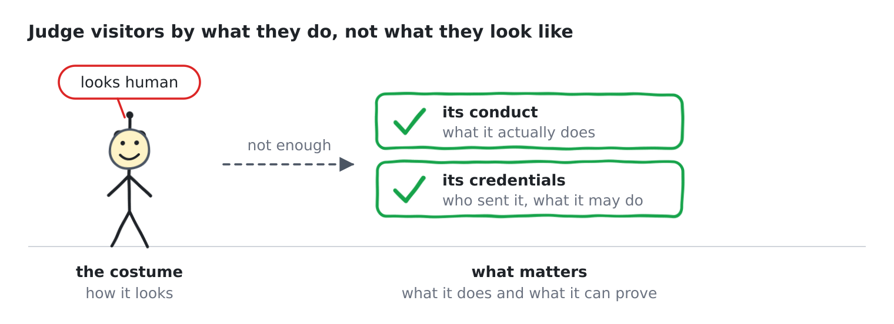

For twenty years the internet asked "are you human?" I think the next twenty will ask something better: who are you, who sent you, and what are you allowed to do here?

More on that soon.
